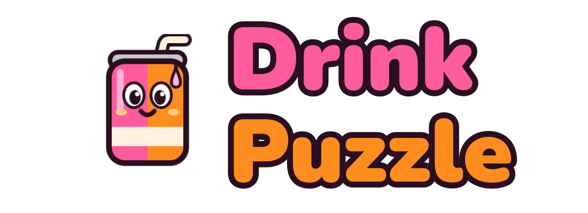

# DrinkPuzzle

A colourful 3D adventure starring **DriP**, a little soda can with a straw.

Run, jump and roll through five worlds – each one long level across floating islands over the
sea, from the start to a golden goal, made for one of DriP's skins: triple-jump up tree trunks in
Sky Jungle, roll through a canyon of steel crates in Soda Desert, float across the sea and ride
the wind on the Frozen Coast, or slip invisible past ghost walls and searchlights in Toxic Night.
Blinking platforms, pistons, conveyor belts and spinning bars are in the way, and every world is
open from the start.

**CheckPrinks** – big glasses that fill up with drink as you pass – are the checkpoints. The
**DriP Coins** you pick up are only kept once you reach the next CheckPrink; fall into the sea and
they go back where they were. Cans and glass shards are never lost.

Each world hides **20 cans** off the main path – under the edges, behind you, high up, in crates
and bushes, far below. Find all **100**, carry them home and pour them into the wooden barrel in
the **Drink Lab**. Reach the goal of each world to earn a glass shard, beat the three Toxic bosses
and build the Giant Glass to mix the **DriP Boost**.

Look out for the **Toxi-drinks**: they shove you around and can squash you. Jump on their heads
to beat them.

Every world has **200 DriP Coins**. Spend them in the Drink Lab's **Pet Shop** on slime pets –
the rarer the colour, the higher the price (125 to 750 coins). Up to three pets hop along behind
DriP.

Open the **map** from the pause menu to teleport to any world.

**Play** keeps up to three save worlds. **Online** lets friends on the same Wi-Fi play together
for free: one creates a world, the others pick it from the list of worlds on the same Wi-Fi, and
everything anyone finds counts for everybody. Every beaten Toxi-drink drops a DriP Coin.

## Download (Android)

Grab **DrinkPuzzle.apk** from the [latest release](../../releases/latest), open it on your phone
and allow installing apps from this source when asked.

## Controls

| | Keyboard / mouse | Touch |
|---|---|---|
| Move | WASD | left stick |
| Camera | mouse / trackpad drag, arrows | drag on the right |
| Jump | Space | jump button |
| Squirt from the straw | F / Shift / J | squirt button |
| Skin ability | Q | ability button |
| Backpack | E / Tab | backpack button |
| Interact (e.g. the Pet Shop) | E | hand button |
| Back to the last CheckPrink | R | |
| Pause | Esc / P | pause button |

Skins: **Classic**, **Roller** (roll like a barrel and smash crates), **Hopper** (triple jump),
**Floaty** (hold jump to float) and **Ghost** (turn invisible).

The source code is private. This repository only hosts the game builds.
